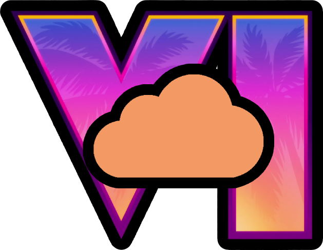

# GTAXC

**GTA VI · CLOUD GAMING · COMMUNITY**

---

### A new project is on the horizon.

GTAXC is an independent fan project exploring GTA VI and cloud gaming on PC.

Follow the development journey, stay up to date, and connect with the community before launch.

## About GTAXC

GTAXC aims to bring together players interested in GTA VI cloud gaming, with a focus on community resources, compatibility research and accessible guides.

| Planned focus | Description |
| :--- | :--- |
| Cloud gaming | Explore supported ways to experience GTA VI through cloud gaming services. |
| Tutorials | Publish guides and helpful resources as information becomes available. |
| Project updates | Share development progress, findings and announcements. |
| Community | Connect with other players through the GTAXC Discord. |

## Project status

**Coming soon.** GTAXC is currently in development. No software release or confirmed launch date is available yet.

Join the [official GTAXC Discord community](https://discord.gg/ks5ShnzVCS) for announcements and future updates.

---

**GTAXC PROJECT**

Independent fan project. Not affiliated with or endorsed by Rockstar Games, Take-Two Interactive, Xbox or Microsoft. Cloud gaming availability and compatibility are not guaranteed.

